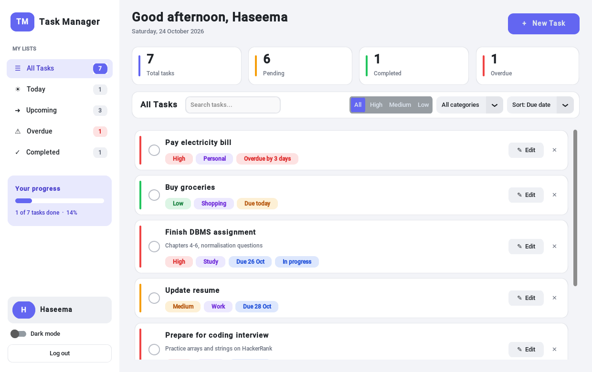
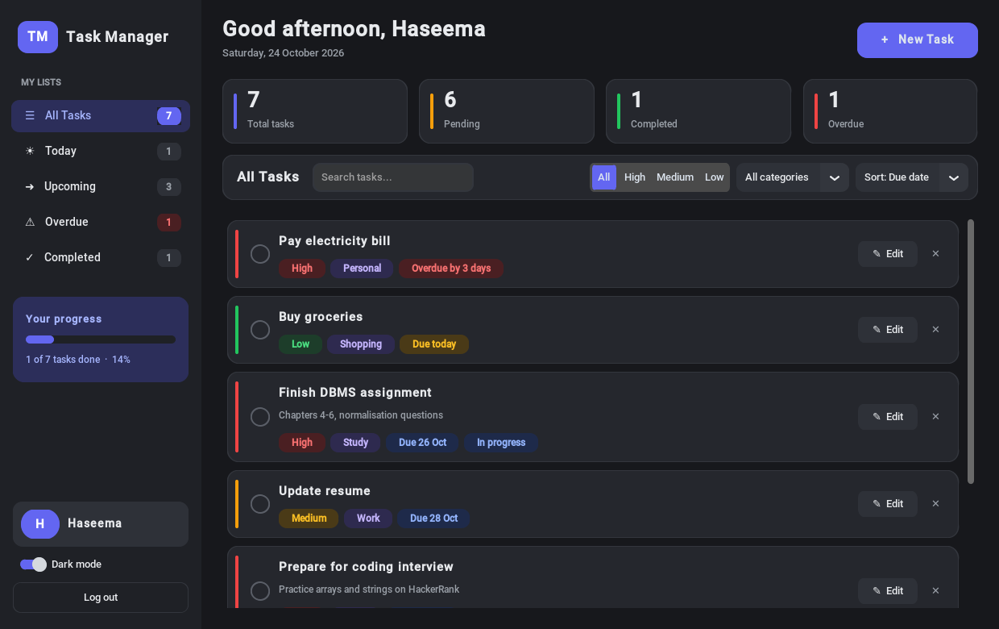
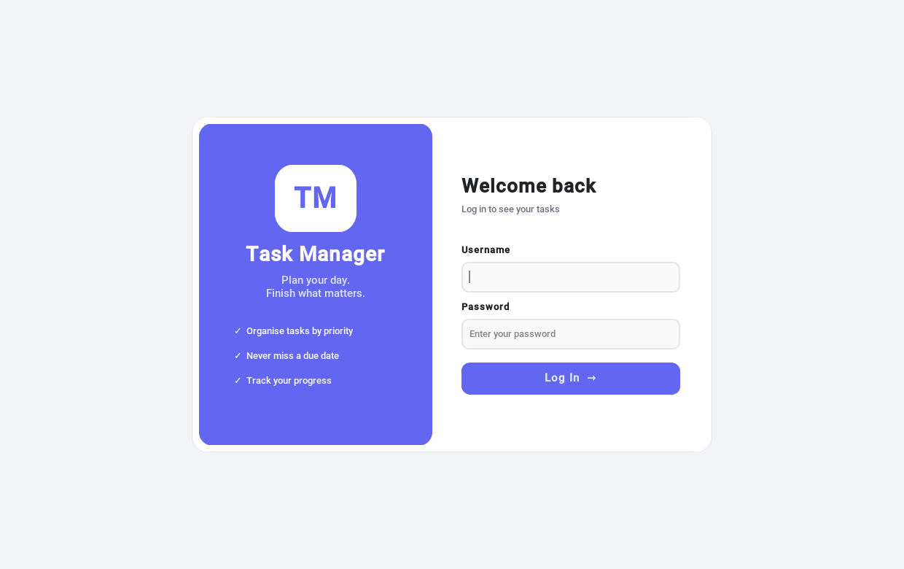
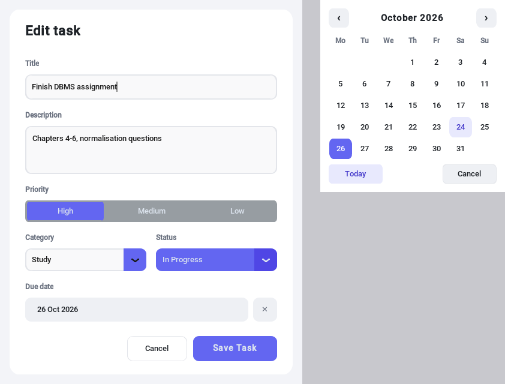

<p align="center">
  
</p>

<h1 align="center">TM · Personal Task Manager</h1>

<p align="center">
  A desktop task manager built with <b>Python, Tkinter and CustomTkinter</b>.<br>
  Add tasks with priority, due date and category, and track your progress.
</p>

---

## Screenshots



| Dark mode | Login |
|---|---|
|  |  |



## Features

- **Login**: create an account on first run. The password is stored as a salted SHA-256 hash in a local config file, never as plain text.
- **CRUD**: add, view, update and delete tasks.
- **Task details**: title, description, priority (High / Medium / Low), due date, category, status.
- **Task cards** with coloured priority badges and due-date chips ("Due today", "Overdue by 3 days").
- **Quick complete**: tick the round checkbox on a card.
- **Calendar date picker** inside the add/edit pop-up.
- **Sidebar lists**: All, Today, Upcoming, Overdue, Completed, each with a live count.
- **Search, filter and sort**: by text, priority, category, due date, title or newest.
- **Dashboard**: stat cards and a progress bar.
- **Toast notifications**, **light / dark mode**, and keyboard shortcut **Ctrl + N** for a new task.
- **File-based storage**: tasks are saved in a text file (one JSON record per line). No database needed.
- **"Load sample tasks"** button for a quick demo.

## Tech stack

Python 3 · Tkinter · CustomTkinter · JSON / text files · hashlib

## How to run

```bash
pip install customtkinter
python task_manager_fancy.py
```

`task_manager.py` is the first, basic version of the app (plain Tkinter, no extra install needed):

```bash
python task_manager.py
```

## Project structure

```
TaskManager/
├── task_manager_fancy.py   # main app (modern UI with CustomTkinter)
├── task_manager.py         # basic version (plain Tkinter)
├── app_icon.ico            # TM icon for the window and taskbar
├── app_icon.png            # TM logo
└── screenshots/            # images for this README
```

Files created when the app runs (not uploaded): `tasks.txt` (tasks) and `config.ini` (login).

## Author

**Haseema** · [GitHub](https://github.com/haseemathasneemka)
